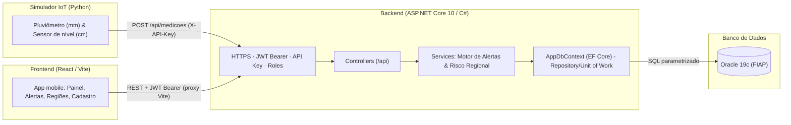
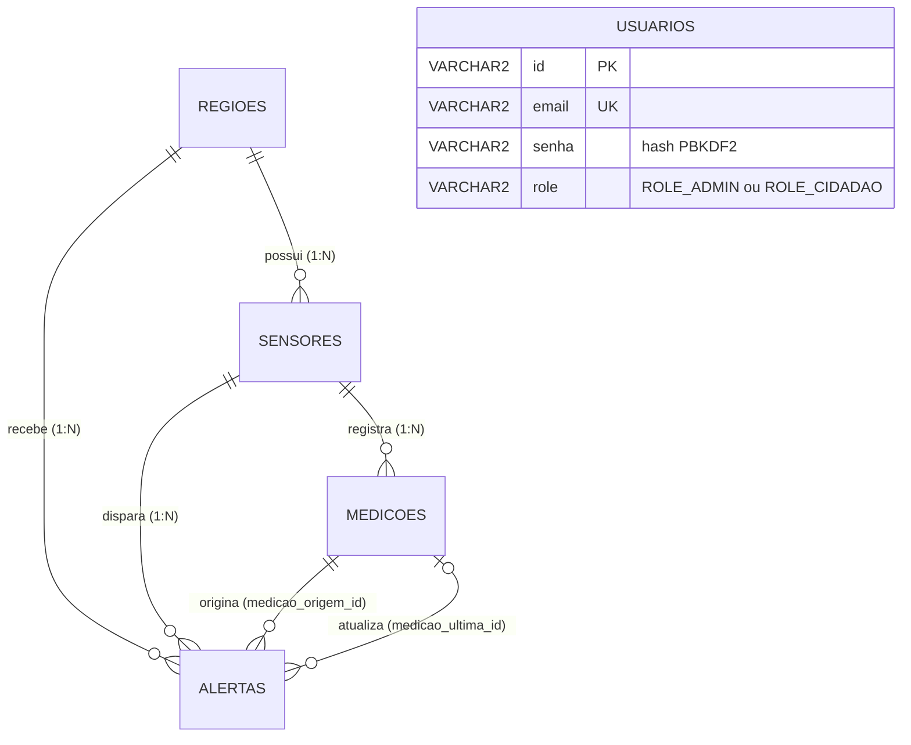

# AlertaJá - Plataforma de Monitoramento de Chuvas e Enchentes com Alertas ao Cidadão

> **AVISO IMPORTANTE / AMBIENTE ACADÊMICO:**
> O **AlertaJá** é um projeto de engenharia de software desenvolvido para fins exclusivamente acadêmicos (Global Solution 2026/2 · CitizenTech · FIAP).
> Todas as leituras de sensores são **FICTÍCIAS**, geradas por um simulador para validar as regras de negócio.
> **NÃO** deve ser utilizado como ferramenta oficial de previsão de desastres ou alerta da Defesa Civil.

[](https://dotnet.microsoft.com/)
[](https://learn.microsoft.com/aspnet/core)
[](https://www.oracle.com/database/)
[](https://react.dev/)
[](https://vitejs.dev/)
[](https://www.python.org/)
[](tests/)
[](docs/testes-e-cenarios/cenarios_de_teste.md)

🎥 **Vídeo pitch:** `INSERIR_LINK_DO_VIDEO_AQUI` · 👥 **Integrantes e RMs:** [`entrega_info.txt`](entrega_info.txt)

---

## 1. Problema e Objetivo

Moradores de bairros às margens de córregos e rios urbanos costumam descobrir a enchente **quando a água já chegou**. A informação de risco existe em formato técnico (milímetros de chuva, centímetros de cota do rio), em escala regional e chega tarde ao cidadão, que precisa de minutos de antecedência para sair com segurança.

O **AlertaJá** resolve esse problema ao fornecer:
1. **Ingestão segura de telemetria IoT:** pluviômetros (chuva em `mm`) e sensores de nível de água (rio em `cm`) enviam leituras para a API por HTTPS com o cabeçalho `X-API-Key`.
2. **Motor de alertas automático:** cada leitura é classificada em 4 níveis (`NORMAL`, `ATENCAO`, `ALERTA`, `PERIGO`) a partir dos limites do sensor; o alerta é **aberto**, **atualizado** quando o nível muda e **resolvido automaticamente** (`RESOLVIDO_AUTO`) quando a leitura volta ao normal.
3. **Risco consolidado por região:** o nível da região é o pior nível entre seus alertas ativos, de modo que a normalização de um sensor não apaga o risco ainda presente em outro.
4. **App mobile para o cidadão:** painel com atualização automática a cada 10 segundos e controle de acesso por perfil (Administrador/Defesa Civil e Cidadão).

| Nível | Regra (por sensor) | Orientação no app |
| :--- | :--- | :--- |
| 🟢 `NORMAL` | valor < limite de atenção | Situação normal |
| 🟡 `ATENCAO` | valor ≥ limite de atenção | Fique atento |
| 🟠 `ALERTA` | valor ≥ limite de alerta | Prepare-se para sair |
| 🔴 `PERIGO` | valor ≥ limite de perigo | Procure local seguro · ligue 199 / 193 |

**ODS atendidos:** 11 (meta 11.5 — reduzir perdas por desastres), 13 (meta 13.1 — resiliência climática), 3, 9 e 10.

---

## 2. Arquitetura e Tecnologias



### Componentes Tecnológicos:
* **Backend:** C# · ASP.NET Core 10 Web API · Entity Framework Core · Oracle.EntityFrameworkCore · JWT Bearer · `PasswordHasher` (ASP.NET Core Identity) · DotNetEnv · OpenAPI.
* **Banco de Dados:** Oracle 19c (servidor `oracle.fiap.com.br`) com PK, FK, UNIQUE, CHECK e índices.
* **Frontend:** React 18, Vite 5, React Router, CSS próprio. Identidade visual baseada na régua linimétrica (régua de medir cheia de rio), logo oficial, modo escuro como padrão (claro opcional no Perfil), layout mobile com moldura de smartphone no desktop e tela cheia no celular.
* **Simulador de Sensores:** Python 3 com `requests` e `python-dotenv`, cenários controlados e modo contínuo.
* **Testes:** Postman Collection com 49 casos e 83 asserções, executada por linha de comando com **Newman** (relatórios HTML/JUnit).

**Camadas da API:** `Controllers` (HTTP, status, autorização) → `Services` (regras de negócio) → `AppDbContext` (EF Core). Cada `DbSet<T>` cumpre o papel de **Repository** e `SaveChangesAsync()` o de **Unit of Work** (medição, alerta e risco da região gravados na mesma transação). Detalhes em [`docs/arquitetura/arquitetura.md`](docs/arquitetura/arquitetura.md).

---

## 3. Modelo Entidade-Relacionamento (DER)



* **Exclusão lógica:** `REGIOES` e `SENSORES` usam o campo `ativo` (0/1), preservando o histórico de medições e alertas.
* **Rastreabilidade:** cada alerta guarda `medicao_origem_id` (leitura que abriu o alerta) e `medicao_ultima_id` (leitura mais recente).
* **Integridade:** `CHECK (limite_atencao < limite_alerta AND limite_alerta < limite_perigo)`, `CHECK (valor >= 0)`, níveis e status restritos por `CHECK`.
* Diagrama completo e dicionário de dados: [`docs/banco-de-dados/der_diagram.md`](docs/banco-de-dados/der_diagram.md).

---

## 4. Instruções de Instalação e Execução

### 4.1. Pré-requisitos
* **.NET SDK:** 10.0.x (`dotnet --version`).
* **Node.js:** 18+ (npm 9+).
* **Python:** 3.10+ (com pip).
* **Oracle:** acesso a um Oracle 19c+ (o grupo usa `oracle.fiap.com.br:1521/ORCL`).
* **Git:** para clonagem e versionamento.

---

### 4.2. Banco de Dados (Oracle)

No SQL Developer, conectado ao seu usuário, execute **`docs/banco-de-dados/script_completo.sql`** (F5 — *Executar Script*). Ele cria as 5 tabelas, constraints e índices e insere a carga inicial (3 usuários, 4 regiões, 7 sensores, 28 medições, 6 alertas). Em seguida, rode `docs/banco-de-dados/consultas.sql` (7 consultas de uso com `JOIN` e agregação).

> O schema do grupo no servidor da FIAP já está criado e populado. Para apenas executar a aplicação, pule esta etapa.

---

### 4.3. Configuração

1. Na raiz do projeto, crie o `.env` a partir do modelo:
   ```powershell
   Copy-Item .env.example .env
   ```
   Preencha `ALERTAJA_API_KEY` (chave compartilhada API ↔ simulador) e `Jwt__Key` (chave Base64 de pelo menos 32 bytes para assinar o JWT).
2. Crie a string de conexão Oracle:
   ```powershell
   Copy-Item backend/AlertaJa.Api/appsettings.Development.example.json backend/AlertaJa.Api/appsettings.Development.json
   ```
   e informe usuário e senha do Oracle. Os dois arquivos estão no `.gitignore`.

---

### 4.4. Executando o Backend (ASP.NET Core)

1. Entre no diretório da API:
   ```powershell
   cd backend/AlertaJa.Api
   ```
2. Restaure, confie no certificado de desenvolvimento (primeira vez) e inicie no perfil HTTPS:
   ```powershell
   dotnet restore
   dotnet dev-certs https --trust
   dotnet run --launch-profile https
   ```
3. A API estará disponível em `https://localhost:7275` (e `http://localhost:5009`).
4. Verificação rápida: `https://localhost:7275/api/status` · Contrato OpenAPI: `https://localhost:7275/openapi/v1.json`.

---

### 4.5. Executando o Frontend (React + Vite)

1. Em outro terminal, acesse o diretório do frontend:
   ```powershell
   cd frontend
   ```
2. Instale as dependências e inicie o servidor de desenvolvimento:
   ```powershell
   npm install
   npm run dev
   ```
3. Acesse `http://localhost:5173`. O Vite encaminha `/api` para `https://localhost:7275` (proxy), dispensando CORS e aceitando o certificado de desenvolvimento.

---

### 4.6. Executando o Simulador de Sensores IoT (Python)

1. Em um terceiro terminal, acesse o diretório do simulador:
   ```powershell
   cd simulator
   ```
2. Instale as dependências:
   ```powershell
   pip install -r requirements.txt
   ```
3. O simulador lê o `.env` da **raiz** do projeto (mesma `ALERTAJA_API_KEY` do backend e ids dos sensores).
4. Execute os cenários:
   ```powershell
   # Bateria completa: normal → atenção → alerta → perigo → recuperação → múltiplos sensores
   python simulate_sensors.py --scenario all

   # Simulação contínua (curva de chuva e cheia do rio) — Ctrl+C para parar
   python simulate_sensors.py --continuous --interval 2.0
   ```
   Com o app aberto no Painel, os alertas aparecem e são resolvidos conforme as leituras chegam. Mais detalhes em [`simulator/README.md`](simulator/README.md).

---

## 5. Credenciais de Demonstração

| Perfil | E-mail | Senha | Autorizações |
| :--- | :--- | :--- | :--- |
| **Administrador** | `admin@alertaja.com` | `admin123` | Cadastro e edição de regiões e sensores, exclusão de alertas, todas as consultas. |
| **Cidadão** | `maria@email.com` | `maria123` | Painel, regiões, sensores, medições e alertas em tempo real. |
| **Cidadão** | `joao@email.com` | `joao123` | Idem. |

---

## 6. Endpoints da API REST

| Método | Endpoint | Proteção | Descrição |
| :--- | :--- | :--- | :--- |
| `GET` | `/api/status` | Pública | Health-check da API. |
| `POST` | `/api/auth/login` | Pública | Autenticação e emissão de Token JWT. |
| `GET` | `/api/regioes` · `/api/regioes/{id}` | Pública | Lista / detalha regiões e nível de risco atual. |
| `POST` | `/api/regioes` | `ROLE_ADMIN` | Cadastro de região monitorada. |
| `PUT` | `/api/regioes/{id}` | `ROLE_ADMIN` | Atualização (inclui ativar/desativar). |
| `GET` | `/api/sensores` · `/api/sensores/{id}` | Pública | Lista / detalha sensores e limites. |
| `POST` | `/api/sensores` | `ROLE_ADMIN` | Cadastro de sensor em região ativa (`Atenção < Alerta < Perigo`, código único → 409). |
| `PUT` | `/api/sensores/{id}` | `ROLE_ADMIN` | Atualização de sensor. |
| `POST` | `/api/medicoes` | `X-API-Key` | **Ingestão de telemetria IoT** com acionamento do motor de alertas e recálculo do risco da região. |
| `GET` | `/api/medicoes` · `/api/medicoes/{id}` | Pública | Histórico de medições. |
| `GET` | `/api/alertas` · `/api/alertas/{id}` | Pública | Central de alertas. |
| `DELETE` | `/api/alertas/{id}` | `ROLE_ADMIN` | Exclusão de alerta. |

Códigos utilizados: `200`, `201` (com `Location`), `204`, `400` (validação), `401`, `403`, `404`, `409`. Documentação completa na **Postman Collection** [`tests/AlertaJa.postman_collection.json`](tests/AlertaJa.postman_collection.json).

---

## 7. Segurança

* **Senhas em hash:** `PasswordHasher<Usuario>` (PBKDF2-HMAC-SHA512, 100.000 iterações, salt aleatório). Nenhuma senha em texto puro.
* **JWT (HS256):** emissor, audiência, assinatura e expiração validados; chave em variável de ambiente (`Jwt__Key`).
* **RBAC:** `[Authorize(Roles = "ROLE_ADMIN")]` em POST/PUT/DELETE; o cidadão recebe `403` e o app oculta ações administrativas.
* **Dispositivos IoT:** `X-API-Key` comparada com `CryptographicOperations.FixedTimeEquals` (evita ataque de tempo); a chave nunca vai para o frontend.
* **HTTPS/TLS:** perfil `https` e `UseHttpsRedirection()`.
* **SQL Injection:** acesso exclusivamente via EF Core com parâmetros (teste CT06).
* **XSS:** a API responde JSON e o React escapa o conteúdo renderizado (sem `dangerouslySetInnerHTML`).
* **Validação de entrada:** DataAnnotations nos DTOs + regras nos Services.
* **Segredos fora do Git:** `.env` e `appsettings.Development.json` ignorados; modelos `.example` versionados.

---

## 8. Execução dos Testes Automatizados

### API (Postman Collection + Newman):
```powershell
# com a API rodando em https://localhost:7275
cd tests
npm install
npm test
```
* Antes, informe a `apiKey` em `tests/AlertaJa.postman_environment.json` (mesmo valor de `ALERTAJA_API_KEY`).
* **Resultado:** 49 requisições, **83 asserções, 0 falhas** (autenticação, RBAC, validações, CRUD, ingestão IoT, abertura/escalonamento/auto-resolução de alertas, recálculo regional, exclusão).
* Relatório HTML: `tests/relatorios/ultima-execucao.html`. Execuções de evidência em [`tests/relatorios/`](tests/relatorios/) (`run1` = código original, 45/49; `run2` = após correções, 49/49).
* Matriz de cenários: [`docs/testes-e-cenarios/cenarios_de_teste.md`](docs/testes-e-cenarios/cenarios_de_teste.md) · Correções: [`docs/CORRECOES_QA.md`](docs/CORRECOES_QA.md).

### Frontend (Build):
```powershell
cd frontend
npm run build
```

### Banco de Dados (validação dos scripts):
```powershell
cd docs/banco-de-dados
pip install oracledb
$env:ORACLE_USER="SEU_RM"; $env:ORACLE_PASSWORD="SUA_SENHA"
python validar_scripts.py validacao.log
```
* Executa DDL + DML em tabelas temporárias `QA_*`, roda as 7 consultas e remove as tabelas. **Resultado:** todos os scripts sem erros.

---

## 9. Materiais Acadêmicos de Entrega

* [`docs/entrega/AlertaJa_Documentacao_Global_Solution.pdf`](docs/entrega/AlertaJa_Documentacao_Global_Solution.pdf): documento com problema, arquitetura, banco, API, segurança, frontend, IoT, plano de testes, ODS e uso de IA.
* [`docs/entrega/PRINTS.pdf`](docs/entrega/PRINTS.pdf) e [`docs/entrega/Evidencias_Testes_API.pdf`](docs/entrega/Evidencias_Testes_API.pdf): evidências de execução.
* [`docs/entrega/Guia_de_Entrega_AlertaJa.pdf`](docs/entrega/Guia_de_Entrega_AlertaJa.pdf): guia da estrutura da entrega.
* [`docs/evidencias/`](docs/evidencias/): prints (frontend, API, IoT e banco), logs de execução, relatórios Newman e `resultados.csv`.
* [`docs/banco-de-dados/`](docs/banco-de-dados/): `db_ddl.sql`, `db_dml.sql`, `script_completo.sql`, `consultas.sql`, DER (`der.png`, `der_diagram.md`).
* [`docs/arquitetura/arquitetura.md`](docs/arquitetura/arquitetura.md): engenharia e fluxos do sistema.
* [`docs/testes-e-cenarios/cenarios_de_teste.md`](docs/testes-e-cenarios/cenarios_de_teste.md): matriz dos 49 casos de teste.
* [`entrega_info.txt`](entrega_info.txt): integrantes, RMs e link do vídeo pitch.

---

## 10. Como Gerar o Arquivo ZIP Limpo para Entrega

* **Windows (PowerShell):**
  ```powershell
  Remove-Item -Recurse -Force backend\AlertaJa.Api\bin, backend\AlertaJa.Api\obj -ErrorAction SilentlyContinue
  Remove-Item -Recurse -Force frontend\node_modules, frontend\dist, tests\node_modules -ErrorAction SilentlyContinue

  Compress-Archive -Path backend, frontend, simulator, tests, docs, entrega_info.txt, README.md, .gitignore, .env.example -DestinationPath AlertaJA_Entrega.zip
  ```

---

## 11. Uso de IA Generativa

| Ferramenta | Para quê |
| :--- | :--- |
| Claude (Anthropic) / Claude Code | Revisão do código e da documentação, conversão da coleção do Insomnia em Postman Collection com testes automatizados, apoio no frontend React e na redação dos documentos. Todo o conteúdo foi revisado pelo grupo e os testes foram executados contra a API e o banco reais. |

---

## 12. Limitações Conhecidas

1. **Dados simulados:** a plataforma consome leituras sintéticas do simulador Python e não se conecta a estações oficiais (CEMADEN, Defesa Civil).
2. **Atualização por polling:** o app consulta a API a cada 10 segundos em vez de WebSockets/push.
3. **Sem paginação** em `GET /api/medicoes` e `GET /api/alertas`.
4. **Alterar limites de um sensor** não reavalia alertas já abertos; não há endpoint de resolução manual (o status `RESOLVIDO_MANUAL` existe no banco).
