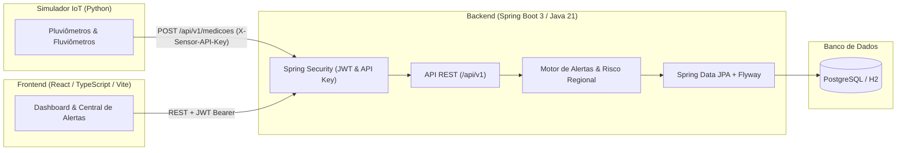
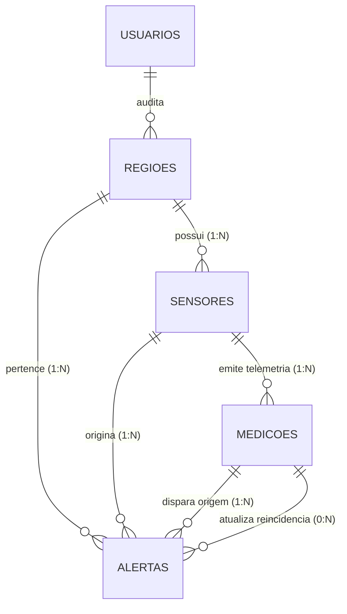

# AlertaJá - Plataforma Integrada de Monitoramento Hidrológico e Gestão de Riscos de Alagamento

> **AVISO IMPORTANTE / AMBIENTE ACADÊMICO:**  
> O **AlertaJá** é um projeto de engenharia de software desenvolvido para fins exclusivamente acadêmicos e educacionais.  
> Todas as leituras telemétricas e dados hidrológicos são **FICTÍCIOS**, simulados por software para validação de regras de negócio.  
> **NÃO** deve ser utilizado como ferramenta oficial de previsão de desastres ou alerta da Defesa Civil.

[](https://www.oracle.com/java/)
[](https://spring.io/projects/spring-boot)
[](https://react.dev/)
[](https://www.typescriptlang.org/)
[](https://www.python.org/)
[](https://www.postgresql.org/)
[](https://flywaydb.org/)
[]()

---

## 1. Problema e Objetivo

Alagamentos urbanos e transbordamentos fluviais causam perdas materiais severas e ameaçam vidas anualmente em grandes centros urbanos. A carência de sistemas automatizados que consolidem dados de múltiplos sensores pluviométricos e fluviométricos em tempo real dificulta a emissão rápida de alertas e a evacuação preventiva de áreas de risco.

O **AlertaJá** resolve esse problema ao fornecer:
1. **Ingestão Telemétrica Segura de IoT:** Recebimento automatizado de volumes de precipitação (chuva em `mm/h`) e cotas de inundação (rios em `m`).
2. **Motor de Alertas Reativo:** Avaliação instantânea em 4 níveis (`NORMAL`, `ATENCAO`, `ALERTA`, `PERIGO`), com mecanismos inteligentes de **anti-duplicação** de ocorrências, **escalonamento** dinâmico e **auto-resolução** na estiagem/vazante.
3. **Cálculo de Risco Regional Multissensor:** Risco da bacia hidrográfica correspondente ao maior risco entre seus sensores ativos, garantindo que a normalização de um sensor não apague um risco ainda persistente em outro dispositivo da mesma região.
4. **Interface de Comando e Controle:** Dashboard em tempo real com **polling automático a cada 10 segundos** e controle de acesso baseado em papéis (RBAC: Administradores e Cidadãos).

---

## 2. Arquitetura e Tecnologias



### Componentes Tecnológicos:
* **Backend:** Java 21 LTS, Spring Boot 3.4.3, Spring Data JPA, Spring Security, Flyway, JJWT (0.12.6), Springdoc OpenAPI 3 (Swagger).
* **Banco de Dados:** PostgreSQL para ambiente de produção/desenvolvimento e H2 em modo PostgreSQL para testes unitários e desenvolvimento local sem dependências externas.
* **Frontend:** React 19, TypeScript, Vite, Axios, React Router DOM, Lucide React, Design System Dark Theme em Vanilla CSS.
* **Simulador de Sensores:** Python 3.12 com bibliotecas `requests` e `python-dotenv`, com cenários climáticos controlados e modo de loop contínuo.

---

## 3. Modelo Entidade-Relacionamento (DER)



* **Exclusão Lógica (*Soft Delete*):** As entidades `Regiao` e `Sensor` utilizam o campo `ativo` (booleano), preservando o histórico completo de medições e ocorrências.
* **Rastreabilidade:** Cada alerta mantém `medicao_origem_id` (gatilho inicial) e `medicao_ultima_id` (última reincidência registrada pelo mecanismo de anti-duplicação).

---

## 4. Instruções de Instalação e Execução

### 4.1. Pré-requisitos
* **Java:** JDK 21 LTS instalado e configurado no `PATH`.
* **Node.js:** Versão 20+ ou 22+ (npm 10+).
* **Python:** Versão 3.10+ (com pip).
* **Git:** Para clonagem e versionamento.

---

### 4.2. Executando o Backend (Spring Boot)

1. Entre no diretório do backend:
   ```bash
   cd backend
   ```
2. Defina a chave obrigatória de telemetria no terminal e inicie a aplicação:
   * **Windows (PowerShell):**
     ```powershell
     $env:SENSOR_INGESTION_API_KEY="chave-secreta-telemetria-2026"
     $env:SPRING_PROFILES_ACTIVE="dev"
     .\mvnw.cmd spring-boot:run
     ```
   * **Linux / macOS (Bash):**
     ```bash
     export SENSOR_INGESTION_API_KEY="chave-secreta-telemetria-2026"
     export SPRING_PROFILES_ACTIVE="dev"
     ./mvnw spring-boot:run
     ```
3. A API estará disponível em `http://localhost:8080`.
4. Documentação interativa Swagger UI: `http://localhost:8080/swagger-ui.html`.

> **Nota sobre o Banco de Dados:** O perfil `dev` utiliza H2 persistido em arquivo (`backend/data/alertajadb`) em modo de compatibilidade estrita com PostgreSQL e Flyway ativado. Caso deseje utilizar PostgreSQL nativo, configure as variáveis de ambiente `SPRING_DATASOURCE_URL`, `SPRING_DATASOURCE_USERNAME` e `SPRING_DATASOURCE_PASSWORD` e utilize o perfil padrão `default`.

---

### 4.3. Executando o Frontend (React + TypeScript)

1. Em outro terminal, acesse o diretório do frontend:
   ```bash
   cd frontend
   ```
2. Instale as dependências:
   ```bash
   npm install
   ```
3. Inicie o servidor de desenvolvimento Vite:
   ```bash
   npm run dev
   ```
4. Acesse a aplicação no navegador em `http://localhost:5173`.

---

### 4.4. Executando o Simulador de Sensores IoT (Python)

1. Em um terceiro terminal, acesse o diretório do simulador:
   ```bash
   cd simulator
   ```
2. Instale as dependências:
   ```bash
   pip install -r requirements.txt
   ```
3. Crie o arquivo `.env` baseado no `.env.example`:
   ```bash
   cp .env.example .env
   ```
   *Certifique-se de que a `SENSOR_INGESTION_API_KEY` seja a mesma configurada no backend.*
4. Execute os cenários demonstrativos:
   ```bash
   # Executa a bateria didática completa de cenários
   python simulate_sensors.py --scenario all

   # Ou execute a simulação contínua com oscilação climática em tempo real
   python simulate_sensors.py --continuous --interval 2.0
   ```

---

## 5. Credenciais de Demonstração

| Perfil | E-mail | Senha | Autorizações |
| :--- | :--- | :--- | :--- |
| **Administrador** | `admin@alertaja.com` | `Admin@123456` | Acesso total: CRUD de regiões e sensores, resolução manual de alertas e painel admin. |
| **Cidadão** | `cidadao@alertaja.com` | `Cidadao@123456` | Visualização de dashboard, consulta de regiões, sensores e alertas em tempo real. |

---

## 6. Endpoints Principais da API REST

| Método | Endpoint | Proteção | Descrição |
| :--- | :--- | :--- | :--- |
| `POST` | `/api/v1/auth/register` | Pública | Cadastro de novas contas de cidadão (`ROLE_CIDADAO`). |
| `POST` | `/api/v1/auth/login` | Pública | Autenticação por credenciais e emissão de Token JWT. |
| `GET` | `/api/v1/auth/me` | Bearer JWT | Retorna dados e permissões do usuário autenticado. |
| `POST` | `/api/v1/medicoes` | `X-Sensor-API-Key` | **Ingestão atômica de telemetria IoT** com acionamento do motor de alertas e recálculo regional. |
| `GET` | `/api/v1/medicoes` | Bearer JWT | Histórico paginado de medições com filtros por sensor, região e datas. |
| `GET` | `/api/v1/regioes` | Bearer JWT | Listagem paginada de bacias com busca por nome e filtro ativo/inativo. |
| `POST` | `/api/v1/regioes` | `ROLE_ADMIN` | Cadastro de nova região monitorada. |
| `DELETE` | `/api/v1/regioes/{id}` | `ROLE_ADMIN` | Desativação lógica (*soft delete*) de região. |
| `GET` | `/api/v1/sensores` | Bearer JWT | Consulta de sensores IoT com parâmetros e limiares de risco. |
| `POST` | `/api/v1/sensores` | `ROLE_ADMIN` | Cadastro de sensor vinculado a região ativa (`Atenção < Alerta < Perigo`). |
| `GET` | `/api/v1/alertas` | Bearer JWT | Central de alertas com filtros por severidade, status e região. |
| `PATCH` | `/api/v1/alertas/{id}/resolver`| `ROLE_ADMIN` | Encerramento manual de alerta ativo. |

---

## 7. Execução dos Testes Automatizados

### Backend (JUnit 5 + Mockito + Testcontainers / H2):
```bash
cd backend
./mvnw test
```
* **Resultado:** 48 testes executados, **0 falhas, 0 erros** (cobrem CRUD, segurança, anti-duplicação, escalonamento, auto-resolução, recálculo regional e rollback transacional).

### Frontend (Build & Tipagem):
```bash
cd frontend
npm run build
```
* **Resultado:** Build de produção aprovado pelo compilador TypeScript e Vite em < 1s.

### Integração Ponta a Ponta:
```bash
python simulator/verify_integration.py
```
* **Resultado:** 100% de sucesso validando autenticação, rejeição de chaves inválidas, persistência e motor de alertas no backend real.

---

## 8. Materiais Acadêmicos de Entrega

Na pasta [`docs/`](file:///c:/Users/GUI/OneDrive/%C3%81rea%20de%20Trabalho/Global-solution/docs) estão disponíveis os materiais complementares solicitados para a avaliação:
* [`docs/banco-de-dados/schema_and_seeds.sql`](file:///c:/Users/GUI/OneDrive/%C3%81rea%20de%20Trabalho/Global-solution/docs/banco-de-dados/schema_and_seeds.sql): Script DDL e seeds compatível com PostgreSQL.
* [`docs/banco-de-dados/consultas_demonstrativas.sql`](file:///c:/Users/GUI/OneDrive/%C3%81rea%20de%20Trabalho/Global-solution/docs/banco-de-dados/consultas_demonstrativas.sql): Cinco consultas SQL analíticas com `JOIN` e agregações.
* [`docs/banco-de-dados/der_diagram.md`](file:///c:/Users/GUI/OneDrive/%C3%81rea%20de%20Trabalho/Global-solution/docs/banco-de-dados/der_diagram.md): Diagrama Entidade-Relacionamento e Dicionário de Dados.
* [`docs/testes-e-cenarios/cenarios_de_teste.md`](file:///c:/Users/GUI/OneDrive/%C3%81rea%20de%20Trabalho/Global-solution/docs/testes-e-cenarios/cenarios_de_teste.md): Matriz de 13 cenários de teste acadêmicos detalhados.
* [`docs/arquitetura/arquitetura.md`](file:///c:/Users/GUI/OneDrive/%C3%81rea%20de%20Trabalho/Global-solution/docs/arquitetura/arquitetura.md): Engenharia e fluxos do sistema.
* [`entrega_info.txt`](file:///c:/Users/GUI/OneDrive/%C3%81rea%20de%20Trabalho/Global-solution/entrega_info.txt): Arquivo com campos para preenchimento dos integrantes, RMs e link do vídeo de apresentação.

---

## 9. Como Gerar o Arquivo ZIP Limpo para Entrega

Para submissão nos portais acadêmicos sem arquivos temporários pesados (`node_modules`, `target`, `.git`), execute a partir da raiz:

* **Windows (PowerShell):**
  ```powershell
  # Remove pastas pesadas de build e dependências locais
  Remove-Item -Recurse -Force backend\target -ErrorAction SilentlyContinue
  Remove-Item -Recurse -Force frontend\node_modules -ErrorAction SilentlyContinue
  Remove-Item -Recurse -Force frontend\dist -ErrorAction SilentlyContinue
  Remove-Item -Recurse -Force backend\data -ErrorAction SilentlyContinue

  # Compacta o projeto
  Compress-Archive -Path backend, frontend, simulator, docs, entrega_info.txt, README.md, .gitignore -DestinationPath AlertaJA_Entrega.zip
  ```

---

## 10. Limitações Conhecidas

1. **Dados Simulados:** A plataforma consome dados sintéticos gerados pelo simulador em Python e não se conecta a redes telemétricas de radares ou estações oficiais do CEMADEN ou Defesa Civil.
2. **Atualização por Polling:** A atualização do frontend é realizada por consultas periódicas a cada 10 segundos (polling HTTP REST) ao invés de canais bidirecionais contínuos (WebSockets), priorizando simplicidade de infraestrutura e previsibilidade acadêmica.
