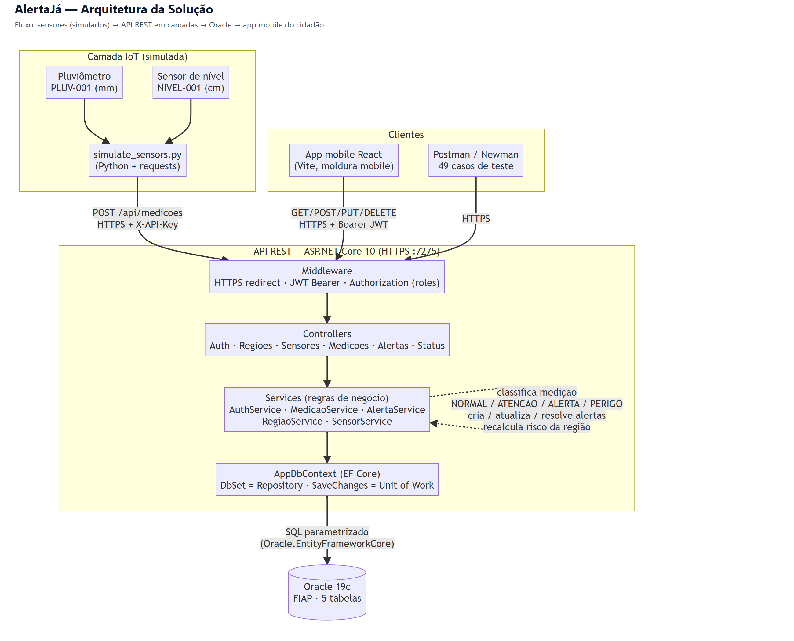
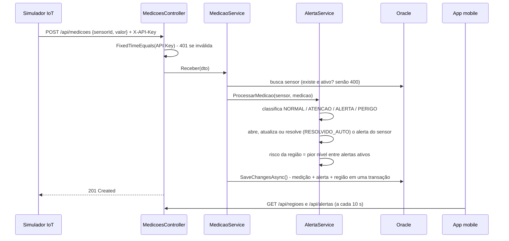

# Arquitetura do AlertaJá



## Componentes

| Componente | Tecnologia | Responsabilidade |
| :--- | :--- | :--- |
| Simulador IoT | Python 3 (`requests`, `python-dotenv`) | Representa pluviômetros e sensores de nível enviando leituras por HTTPS com `X-API-Key`. |
| API REST | C# · ASP.NET Core 10 · EF Core | Autenticação, autorização, CRUD, ingestão de medições e motor de alertas. |
| Banco de dados | Oracle 19c | Persistência de usuários, regiões, sensores, medições e alertas. |
| App mobile | React 18 + Vite | Interface do cidadão e do administrador; consome a API por proxy do Vite. |
| Testes | Postman Collection + Newman | 49 casos de teste de API executados por comando. |

## Camadas da API (`backend/AlertaJa.Api`)

```text
Program.cs                → carrega o .env, configura EF Core (Oracle), JWT, autorização, HTTPS, OpenAPI
Controllers/              → entrada HTTP, status codes, [Authorize(Roles = "ROLE_ADMIN")], validação da API Key
  AuthController            POST /api/auth/login
  RegioesController         GET/POST/PUT /api/regioes
  SensoresController        GET/POST/PUT /api/sensores
  MedicoesController        GET/POST /api/medicoes  (POST exige X-API-Key)
  AlertasController         GET/DELETE /api/alertas
  StatusController          GET /api/status
Services/                 → regras de negócio
  AuthService               verifica o hash (PasswordHasher) e emite o JWT
  MedicaoService            valida e registra a medição, atualiza ultima_leitura, aciona o AlertaService
  AlertaService             classifica, abre/atualiza/resolve alertas, recalcula o risco da região
  RegiaoService / SensorService   CRUD e validações (limites em ordem, região ativa, código único)
Data/AppDbContext.cs      → mapeamento EF Core ↔ tabelas Oracle (DbSet = Repository, SaveChanges = Unit of Work)
Models/ · DTOs/ · Enums/  → entidades, contratos de entrada/saída e TipoSensor
```

## Fluxo de ingestão (sensor → alerta → app)



## Decisões de projeto

* **Sem camada Repository genérica:** o EF Core já oferece `DbSet<T>` (repositório) e `SaveChangesAsync()` (unidade de trabalho); um repositório que só repassasse chamadas duplicaria a abstração.
* **GUIDs como chave primária**, gerados pela aplicação: permitem criar medição e alerta relacionados antes de gravar, numa única transação.
* **Proxy do Vite** no frontend: evita configurar CORS na API e aceita o certificado HTTPS de desenvolvimento.
* **API Key separada do JWT:** dispositivos IoT não têm usuário; a chave autentica o envio de leituras sem expor credenciais de pessoas.
