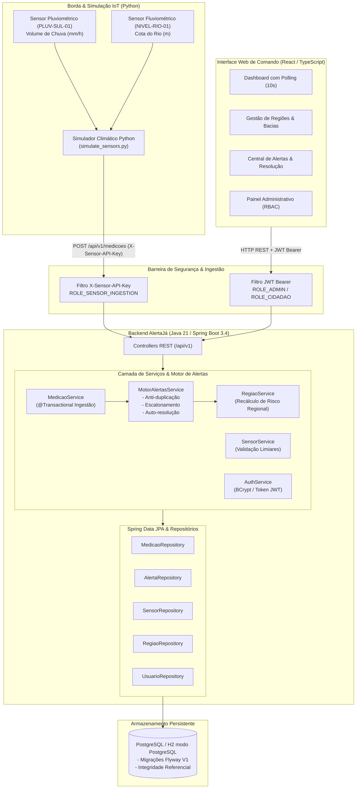
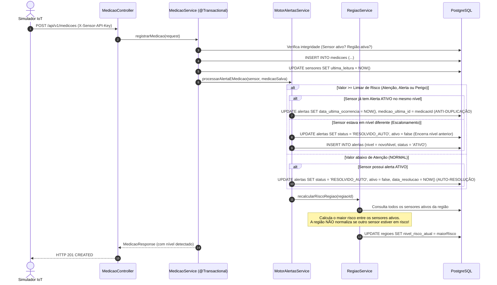

# AlertaJá - Arquitetura de Software e Engenharia do Sistema

O **AlertaJá** é uma plataforma distribuída desenvolvida para monitoramento contínuo de riscos hidrológicos e alagamentos urbanos, integrando telemetria em tempo real de sensores pluviométricos e fluviométricos, motor de regras de alerta automatizado e interface de comando e controle para cidadãos e equipes de resposta civil.

---

## 1. Diagrama de Arquitetura do Sistema

---

## 2. Fluxo de Vida de uma Medição e do Motor de Alertas

---

## 3. Pilares Arquiteturais

1. **Separação de Papéis e Credenciais (Zero Trust Telemetria):**
   * Dispositivos de telemetria não utilizam credenciais de usuários (JWT), mas sim a chave de cabeçalho `X-Sensor-API-Key`.
   * Cidadãos autenticados não possuem autorização de telemetria (`ROLE_SENSOR_INGESTION`), impedindo injeção forjada de dados meteorológicos.
   * Administradores (`ROLE_ADMIN`) são os únicos com autoridade para cadastrar, editar, desativar regiões/sensores e resolver alertas manualmente.

2. **Consistência Transacional Estrita (`@Transactional`):**
   * A persistência da medição, o acionamento do motor de alertas e o recálculo do risco regional são executados sob o mesmo contexto transacional. Qualquer erro imprevisto aciona o rollback imediato no banco, impedindo inconsistência no estado dos dados.

3. **Exclusão Lógica e Rastreabilidade (*Soft Delete*):**
   * Regiões e sensores possuem a flag `ativo = true/false`. Desativações preservam o histórico de medições anteriores para fins periciais e estatísticos.
   * Cada alerta armazena a `medicao_origem_id` (leitura que abriu a crise) e `medicao_ultima_id` (leitura mais recente em caso de reincidência contínua).
