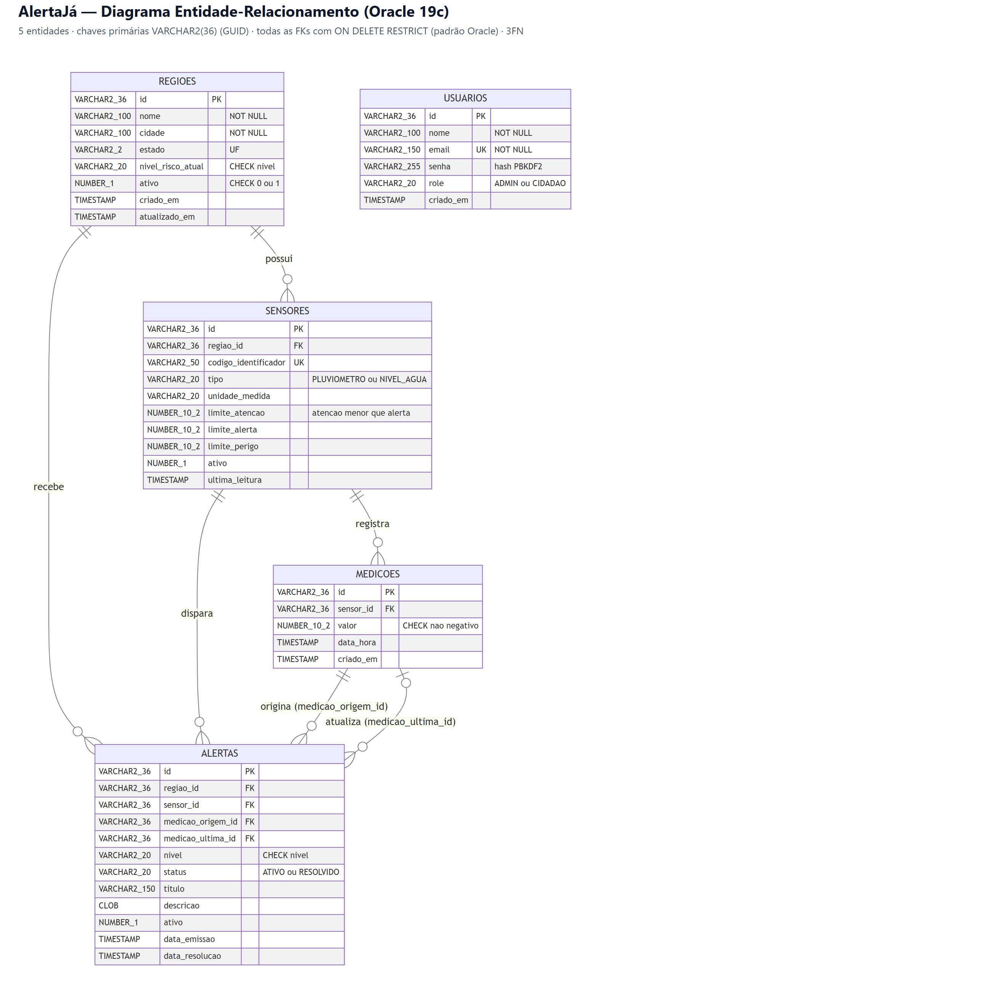

# Diagrama Entidade-Relacionamento e Dicionário de Dados

Banco: **Oracle 19c** · 5 entidades · 3ª Forma Normal · chaves primárias `VARCHAR2(36)` (GUID gerado pela aplicação).

| Relacionamento | Cardinalidade | FK |
| :--- | :--- | :--- |
| REGIOES → SENSORES | 1:N | `sensores.regiao_id` |
| REGIOES → ALERTAS | 1:N | `alertas.regiao_id` |
| SENSORES → MEDICOES | 1:N | `medicoes.sensor_id` |
| SENSORES → ALERTAS | 1:N | `alertas.sensor_id` |
| MEDICOES → ALERTAS (origem) | 1:N | `alertas.medicao_origem_id` (obrigatória) |
| MEDICOES → ALERTAS (última) | 0..1:N | `alertas.medicao_ultima_id` (opcional) |

`USUARIOS` não possui FK: guarda credenciais e perfil para autenticação.

## Dicionário de dados

### USUARIOS
| Coluna | Tipo | Restrições | Descrição |
| :--- | :--- | :--- | :--- |
| id | VARCHAR2(36) | PK | GUID |
| nome | VARCHAR2(100) | NOT NULL | Nome do usuário |
| email | VARCHAR2(150) | NOT NULL, UNIQUE | Login |
| senha | VARCHAR2(255) | NOT NULL | Hash PBKDF2 (ASP.NET Core `PasswordHasher`) |
| role | VARCHAR2(20) | NOT NULL, CHECK (`ROLE_ADMIN`, `ROLE_CIDADAO`) | Perfil de acesso |
| criado_em | TIMESTAMP | DEFAULT CURRENT_TIMESTAMP | — |

### REGIOES
| Coluna | Tipo | Restrições | Descrição |
| :--- | :--- | :--- | :--- |
| id | VARCHAR2(36) | PK | GUID |
| nome / cidade | VARCHAR2(100) | NOT NULL | Bairro/área e município |
| estado | VARCHAR2(2) | NOT NULL | UF |
| nivel_risco_atual | VARCHAR2(20) | DEFAULT 'NORMAL', CHECK (NORMAL, ATENCAO, ALERTA, PERIGO) | Pior nível entre os alertas ativos |
| ativo | NUMBER(1) | DEFAULT 1, CHECK (0,1) | Exclusão lógica |
| criado_em / atualizado_em | TIMESTAMP | — | Auditoria |

### SENSORES
| Coluna | Tipo | Restrições | Descrição |
| :--- | :--- | :--- | :--- |
| id | VARCHAR2(36) | PK | GUID |
| regiao_id | VARCHAR2(36) | FK → REGIOES, NOT NULL | Região monitorada |
| codigo_identificador | VARCHAR2(50) | NOT NULL, UNIQUE | Ex.: PLUV-001 |
| tipo | VARCHAR2(20) | CHECK (PLUVIOMETRO, NIVEL_AGUA) | Tipo do sensor |
| unidade_medida | VARCHAR2(20) | NOT NULL | mm ou cm |
| limite_atencao / limite_alerta / limite_perigo | NUMBER(10,2) | NOT NULL, CHECK (atenção < alerta < perigo) | Faixas de classificação |
| ativo | NUMBER(1) | DEFAULT 1, CHECK (0,1) | Exclusão lógica |
| ultima_leitura | TIMESTAMP | — | Data da última medição recebida |

### MEDICOES
| Coluna | Tipo | Restrições | Descrição |
| :--- | :--- | :--- | :--- |
| id | VARCHAR2(36) | PK | GUID |
| sensor_id | VARCHAR2(36) | FK → SENSORES, NOT NULL | Sensor de origem |
| valor | NUMBER(10,2) | NOT NULL, CHECK (valor >= 0) | Leitura |
| data_hora / criado_em | TIMESTAMP | DEFAULT CURRENT_TIMESTAMP | — |

### ALERTAS
| Coluna | Tipo | Restrições | Descrição |
| :--- | :--- | :--- | :--- |
| id | VARCHAR2(36) | PK | GUID |
| regiao_id / sensor_id | VARCHAR2(36) | FK, NOT NULL | Onde e qual sensor |
| medicao_origem_id | VARCHAR2(36) | FK → MEDICOES, NOT NULL | Leitura que abriu o alerta |
| medicao_ultima_id | VARCHAR2(36) | FK → MEDICOES | Leitura mais recente |
| nivel | VARCHAR2(20) | CHECK (NORMAL, ATENCAO, ALERTA, PERIGO) | Severidade |
| status | VARCHAR2(20) | CHECK (ATIVO, RESOLVIDO_AUTO, RESOLVIDO_MANUAL) | Situação |
| titulo / descricao | VARCHAR2(150) / CLOB | — | Texto do alerta |
| ativo | NUMBER(1) | CHECK (0,1) | Aberto/encerrado |
| data_emissao / data_ultima_ocorrencia / data_resolucao | TIMESTAMP | — | Linha do tempo |

Índices: `idx_regioes_ativo`, `idx_sensores_regiao`, `idx_medicoes_sensor_data`, `idx_alertas_regiao_ativo`, `idx_alertas_status`.

## Scripts

| Arquivo | Conteúdo |
| :--- | :--- |
| `db_ddl.sql` | CREATE TABLE, constraints e índices |
| `db_dml.sql` | Carga inicial (3 usuários, 4 regiões, 7 sensores, 28 medições, 6 alertas) |
| `script_completo.sql` | DDL + DML num único arquivo |
| `consultas.sql` | 7 consultas de uso com JOIN e agregação |
| `validar_scripts.py` | Executa tudo em tabelas `QA_*` temporárias e as remove ao final |
