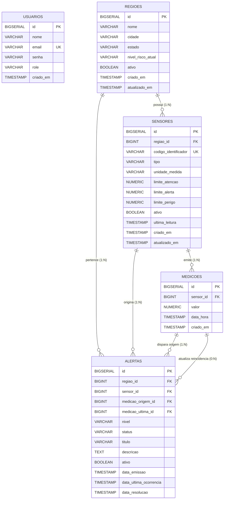

# AlertaJá - Diagrama Entidade-Relacionamento (DER) e Dicionário de Dados

## 1. Diagrama Entidade-Relacionamento (Mermaid)

---

## 2. Dicionário de Dados

### 2.1. Tabela: `usuarios`
Armazena os usuários do sistema com separação de perfis de acesso (RBAC).

| Campo | Tipo | Nulo? | Chave | Descrição |
| :--- | :--- | :---: | :---: | :--- |
| `id` | `BIGSERIAL` | Não | PK | Identificador numérico sequencial único |
| `nome` | `VARCHAR(100)` | Não | - | Nome completo do usuário |
| `email` | `VARCHAR(150)` | Não | UK | E-mail de login exclusivo do usuário |
| `senha` | `VARCHAR(255)` | Não | - | Hash criptográfico seguro (BCrypt cost 12) |
| `role` | `VARCHAR(20)` | Não | - | Papel no sistema: `ROLE_ADMIN` ou `ROLE_CIDADAO` |
| `criado_em` | `TIMESTAMP` | Não | - | Data e hora de criação da conta |

### 2.2. Tabela: `regioes`
Representa as bacias hidrográficas, microbacias e setores monitorados.

| Campo | Tipo | Nulo? | Chave | Descrição |
| :--- | :--- | :---: | :---: | :--- |
| `id` | `BIGSERIAL` | Não | PK | Identificador único da região |
| `nome` | `VARCHAR(100)` | Não | - | Nome descritivo da bacia ou setor urbano |
| `cidade` | `VARCHAR(100)` | Não | - | Município onde a bacia está localizada |
| `estado` | `VARCHAR(2)` | Não | - | Sigla da unidade federativa (ex: SP) |
| `nivel_risco_atual` | `VARCHAR(20)` | Não | - | Risco consolidado: `NORMAL`, `ATENCAO`, `ALERTA`, `PERIGO` |
| `ativo` | `BOOLEAN` | Não | - | Indicador de exclusão lógica (*soft delete*) |
| `criado_em` | `TIMESTAMP` | Não | - | Registro de criação no sistema |
| `atualizado_em` | `TIMESTAMP` | Sim | - | Última modificação cadastral |

### 2.3. Tabela: `sensores`
Representa os dispositivos físicos ou estações telemétricas IoT instaladas nas bacias.

| Campo | Tipo | Nulo? | Chave | Descrição |
| :--- | :--- | :---: | :---: | :--- |
| `id` | `BIGSERIAL` | Não | PK | Identificador sequencial do sensor |
| `regiao_id` | `BIGINT` | Não | FK | Chave estrangeira para `regioes(id)` |
| `codigo_identificador`| `VARCHAR(50)` | Não | UK | Código mnemônico exclusivo (ex: `PLUV-SUL-01`) |
| `tipo` | `VARCHAR(20)` | Não | - | Tipo: `PLUVIOMETRO` ou `NIVEL_AGUA` |
| `unidade_medida` | `VARCHAR(20)` | Não | - | Unidade de engenharia (`mm/h` ou `m`) |
| `limite_atencao` | `NUMERIC(10,2)`| Não | - | Limiar de entrada em situação de Atenção |
| `limite_alerta` | `NUMERIC(10,2)`| Não | - | Limiar de entrada em situação de Alerta |
| `limite_perigo` | `NUMERIC(10,2)`| Não | - | Limiar de entrada em situação de Perigo Crítico |
| `ativo` | `BOOLEAN` | Não | - | Status operacional (*soft delete*) |
| `ultima_leitura` | `TIMESTAMP` | Sim | - | Carimbo da última telemetria registrada |
| `criado_em` | `TIMESTAMP` | Não | - | Data de instalação / cadastro |
| `atualizado_em` | `TIMESTAMP` | Sim | - | Data da última atualização de parâmetros |

> **Constraint de Negócio:** `CHECK (limite_atencao < limite_alerta AND limite_alerta < limite_perigo)`.

### 2.4. Tabela: `medicoes`
Histórico imutável de telemetria recebida através da API de ingestão de sensores.

| Campo | Tipo | Nulo? | Chave | Descrição |
| :--- | :--- | :---: | :---: | :--- |
| `id` | `BIGSERIAL` | Não | PK | Identificador sequencial da medição |
| `sensor_id` | `BIGINT` | Não | FK | Chave estrangeira para `sensores(id)` |
| `valor` | `NUMERIC(10,2)`| Não | - | Valor numérico da leitura telemétrica ($\ge 0$) |
| `data_hora` | `TIMESTAMP` | Não | - | Data e hora em que a amostra foi coletada |
| `criado_em` | `TIMESTAMP` | Não | - | Data e hora em que foi persistida no banco |

### 2.5. Tabela: `alertas`
Histórico e incidentes em tempo real processados pelo motor de alertas.

| Campo | Tipo | Nulo? | Chave | Descrição |
| :--- | :--- | :---: | :---: | :--- |
| `id` | `BIGSERIAL` | Não | PK | Identificador do alerta |
| `regiao_id` | `BIGINT` | Não | FK | Região geográfica associada |
| `sensor_id` | `BIGINT` | Não | FK | Sensor responsável pela detecção |
| `medicao_origem_id`| `BIGINT` | Não | FK | Medição inicial que abriu o alerta |
| `medicao_ultima_id`| `BIGINT` | Sim | FK | Medição da reincidência mais recente (anti-duplicação) |
| `nivel` | `VARCHAR(20)` | Não | - | Severidade: `NORMAL`, `ATENCAO`, `ALERTA`, `PERIGO` |
| `status` | `VARCHAR(20)` | Não | - | Status: `ATIVO`, `RESOLVIDO_AUTO`, `RESOLVIDO_MANUAL` |
| `titulo` | `VARCHAR(150)` | Não | - | Resumo do incidente |
| `descricao` | `TEXT` | Sim | - | Detalhamento circunstancial do incidente |
| `ativo` | `BOOLEAN` | Não | - | `TRUE` se em aberto, `FALSE` se encerrado |
| `data_emissao` | `TIMESTAMP` | Não | - | Data e hora de disparo inicial do alerta |
| `data_ultima_ocorrencia`| `TIMESTAMP` | Sim | - | Carimbo da última amostra crítica recebida |
| `data_resolucao` | `TIMESTAMP` | Sim | - | Carimbo de encerramento do alerta |
